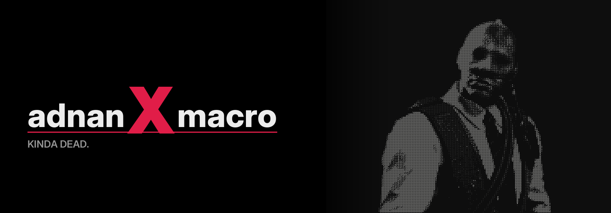

# GitHub Stats

## Open Source Contributions

- **Project Xpark** — Download handler (added), patched hotfix 772
- **Perfect Cube Minecraft Launcher** — Backend development, store implementation
- **Morph** — Patched email login for morphed reddit
- **Quiz Chaos** — Fullstack, regular maintenance
- **Fireflies, a tribute to the souls that died too early** — Project management, archive building
- **trecK** — Backend development
- **Open Tube** — Developer and owner of ragedoll engine

## Catch me with my pants down @:

&nbsp;&nbsp;

&nbsp;&nbsp;

&nbsp;&nbsp;

&nbsp; I promise I'll upload D2 Problem solving videos soon 🙏

 
Discord: beingadnan

